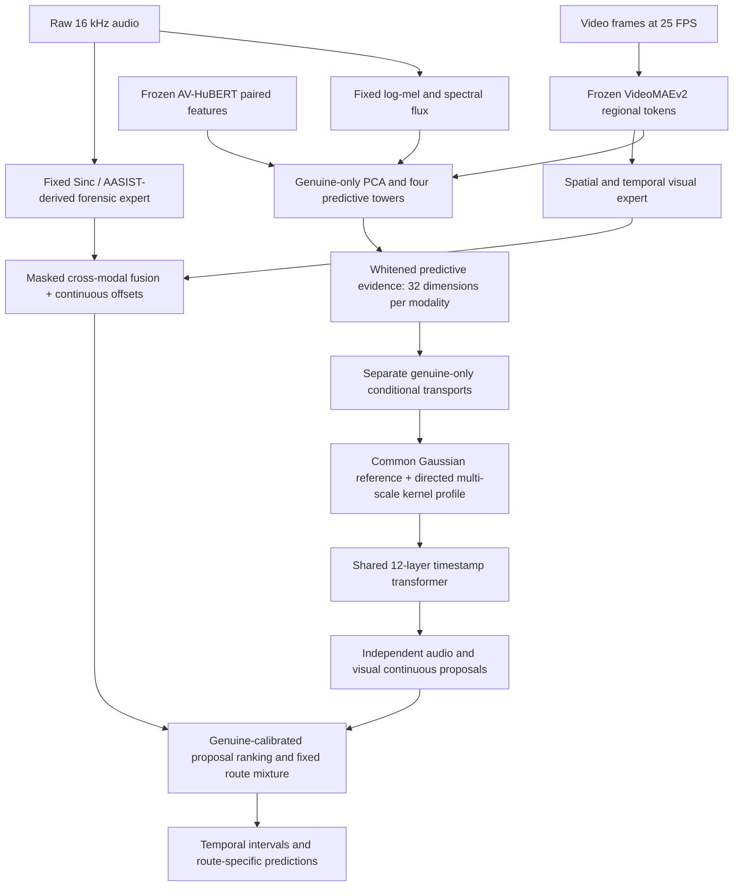

# ReBound architecture and mathematics

## Research hypothesis

An unseen forgery can sometimes be localized through a temporal departure from a genuine conditional distribution, even when its modality has never received forged training labels. Audio and video need not share raw semantics or identical artifact statistics. They need a useful common *reference for genuine predictive evidence*. This is a falsifiable hypothesis, not an assumption that all generators leave the same signal.

The proposed contribution is the combination of conditional real-reference evidence, a shared temporal boundary operator, and continuous endpoints alongside preserved forensic experts. Whitening, flows, MMD, transformers, and the borrowed experts are established components. Novelty of this complete combination requires a separate literature and empirical assessment; the following propositions are not claimed as new mathematical theorems.

## Computation graph

## 1. Preserve forensic information

The private route consumes raw audio and regional visual tokens rather than compressing both through the reference bottleneck. Its audio expert is the attributed AVIGIL a3 localizer: fixed mel-spaced Sinc filters, a multiscale residual CNN, graph interactions and a fine temporal decoder. The visual expert uses frozen VideoMAEv2 global + 2×2 regional tokens, spatial attention, temporal blocks and a time-preserving graph. Gated cross-modal messages form a joint private route. All three heads receive their own correct supervision; a visual-only manipulation does not create a forged audio label.

The audio grid is `(64 + 243j)/16000` seconds, about 15.19 ms apart. Video regional tokens are centered at `0.04 + 0.08j` seconds; the expert predicts at `0.02 + 0.04j`. Alignment uses these timestamps. Short audio clips are grouped by actual length and cropped before graph attention, so padded graph nodes do not become keys. Allocated upstream parameters that its forward never uses are frozen explicitly. No released mixed-forgery checkpoint is loaded.

## 2. Learn only genuine conditional prediction

At 25 Hz, the audio reference view concatenates AV-HuBERT audio (768) with fixed log-mel and flux (140): **908 channels**. The video view concatenates AV-HuBERT video (768), VideoMAEv2 global (768), and regional standard deviation (768): **2304 channels**. Separate PCA projections to 512 dimensions are fitted on genuine fitting families only. PCA is not invertible; it can discard forgery evidence. The raw private route therefore remains necessary.

Four width-768, 6-layer, 12-head towers predict audio-self, video-self, audio-from-video and video-from-audio. Self prediction uses alternating masked blocks; evidence extraction evaluates every mask fold. Cross prediction has no target-modality input. Each tower predicts a low-rank Gaussian:

\[
 p_\theta(h_t^m\mid c_t)=\mathcal N(\mu_t^m,\Sigma_t^m),\qquad
 \Sigma_t^m=\operatorname{diag}(d_t^m)+U_t^m(U_t^m)^\top,\quad d_t^m>0.
\]

Training minimizes mean negative log likelihood, normalized by dimension, over genuine windows. Cross predictors score all valid positions; self predictors score only masked positions. The covariance rank is 16. Linear algebra is performed in float32 even with BF16 neural activations.

For residual whitening, set `B=D^{-1/2}U` and `w=D^{-1/2}(h−μ)`. If `BᵀB=VΛVᵀ`, the implemented correction is

\[
 r=\left[I-BV\,\operatorname{diag}\!\left(\frac{1}{\sqrt{1+\lambda_i}(1+\sqrt{1+\lambda_i})}\right)V^\top B^\top\right]w.
\]

This applies `(I+BBᵀ)^{-1/2}` without constructing a 512×512 inverse square root. Under a correctly specified conditional Gaussian, `Cov(r | c)=I`. **This covariance identity does not imply that finite learned residuals are exactly Gaussian or forgery invariant.** The unit test verifies the matrix identity.

A fixed seeded orthogonal projection retains 12 dimensions from each self/cross residual. Eight additional statistics describe energies, self/cross agreement, temporal differences, lag cosine and predictive surprise, producing a **32-dimensional evidence vector** `e_t^m`. Neither the projection nor these statistics is claimed sufficient for all manipulations.

## 3. Map genuine evidence to a common reference

Each modality has a four-layer affine autoregressive conditional flow `T_m`; its condition is the *previous* evidence vector, never the observation being scored. Train it on reserved genuine reference families, disjoint from predictor-fitting and calibration families:

\[
 \mathcal L_{\mathrm{ref}}^m
 =\mathbb E_{P_{\mathrm{real}}^m}
 \left[\tfrac12\|T_m(e_t\mid e_{t-1})\|^2+\tfrac d2\log(2\pi)
       -\log|\det J_{T_m}(e_t\mid e_{t-1})|\right]/d.
\]

Each affine layer is triangular, with scale `exp(2 tanh(s/2))`, making it invertible with tractable log determinant. Separate standardization is fitted only on genuine reference examples. The first crop position, whose lag/derivative is undefined, is excluded from flow likelihood fitting. Context and evidence are computed on the same overlapping 4-second windows at fitting and inference.

**Ideal reference proposition.** With continuous strictly positive conditional densities, the conditional Rosenblatt transform followed by coordinatewise inverse Gaussian CDF maps the real conditional distribution to `N(0,I)`. This follows by successive conditional probability-integral transforms. The implemented finite affine flow approximates this ideal; maximum likelihood does not certify exact transport.

**Information limit.** An invertible transport cannot make identical observed real/fake distributions distinguishable. If a forgery has `Q_m=P_m` in the retained evidence, its transformed law remains identical. Aligning `T_A#P_A` and `T_V#P_V` also imposes no equality between `T_A#Q_A` and `T_V#Q_V`. Thus cross-modality transfer requires detectable and sufficiently learnable departures in the evidence; alignment alone does not prove transfer.

## 4. Directed reference change profiles

For transformed evidence `z_t^m`, form left/right windows at scales 80, 160 and 320 ms. Each side uses eight temporal anchors, with explicit availability masks. The reference is `G=N(0,I)`. Use the Gaussian kernel

\[
 k_\beta(x,y)=\exp[-\|x-y\|^2/(2\beta)],\qquad \beta\in\{d/2,d,2d\}.
\]

The Gaussian reference expectations are analytic:

\[
 \mathbb E_{g\sim G}k_\beta(x,g)
 =\left(\frac{\beta}{\beta+1}\right)^{d/2}
   e^{-\|x\|^2/[2(\beta+1)]},\quad
 \mathbb E_{g,g'\sim G}k_\beta(g,g')
 =\left(\frac{\beta}{\beta+2}\right)^{d/2}.
\]

For each scale compute `A_L=MMD²(P_L,G)`, `A_R=MMD²(P_R,G)`, `D=MMD²(P_L,P_R)`, `Δ=A_R−A_L`, and a support indicator, averaging over the three bandwidths. The implementation uses biased empirical MMD (including diagonals), which is nonnegative up to roundoff. These statistics are not p-values; repeated anchors and temporal dependence invalidate an independent-sample interpretation.

**Population boundary proposition.** Suppose the real law is exactly `G`, a stationary forged law is `Q≠G`, and left/right windows lie entirely on opposite sides of an abrupt boundary. A Gaussian kernel is characteristic, so `δ=MMD²(Q,G)>0`. At a start, `(A_L,A_R,D,Δ)=(0,δ,δ,δ)`; at an end it is `(δ,0,δ,−δ)`. Therefore the conceptual scores `[Δ]_+D` and `[−Δ]_+D` identify opposite directions in this idealization. This is a direct substitution argument; it does not establish finite-sample localization accuracy. Mixed windows, real content transitions, flow mismatch and gradual synthesis all violate parts of the idealization.

The transformer receives `z` and these profiles, rather than forcing the ideal sign rule as the final decoder.

## 5. Share boundary learning, preserve unseen proposals

A width-512, 12-layer, 8-head transformer processes 32 evidence channels plus 15 profile channels. Attention has a learned per-head timestamp bias and a 0.5-second local window; padded keys are masked. There is no modality embedding in this shared operator.

Initial boundary pretraining uses only synthetic reference-space episodes: mean shifts, scale changes, coupled mean/scale changes, gradual ramps, anisotropic covariance changes, and serial correlation with unchanged stationary marginals. A quarter of each four-episode item is genuine. Synthetic boundaries have fractional timestamp offsets. These episodes define useful training tasks, not evidence of performance on real generated forgeries. First experiments freeze the shared head after proxy pretraining; neither source-forgery expert can suppress or update it.

Both private and shared heads predict frame/start/end logits and continuous endpoint offsets:

\[
 \widehat b_t=t_t+\Delta_t\,a\tanh(u_t).
\]

The range `a=1` on the reference grid covers a final subframe boundary; native experts use `a=3` to account for the valid-convolution tail. Only the nearest valid timestamp receives an offset target. A crop that begins/ends inside a forged region does not create a new boundary; such boundary targets are censored. Loss combines weighted frame BCE, Dice, focal boundary terms, and Smooth-L1 offsets. Private heads additionally receive clip BCE and joint modality attribution CE.

The offset removes a grid quantization constraint. It does not recover timing information absent from the inputs or annotations. In particular, high AP at IoU .95 on short intervals demands both strong features and reliable annotation timestamps.

## 6. Inference and calibration

Run identical overlapping 4-second windows at a 2-second hop, with final windows aligned to the shared 80 ms tubelet grid. Blend logits and *absolute endpoint times* using triangular weights and timestamp interpolation; do not blend normalized offsets on mismatched grids. Frame runs propose regions; nearby start/end peaks refine continuous edges. Weak boundaries at a clip edge can use the observed clip boundary. Clip support is limited to the common decoded AV and AV-HuBERT timeline; the full-clip evaluator retains original GT so truncation is not silently forgiven.

Keep three candidate sets: private joint, shared audio, shared visual. On held-out genuine calibration families, record the maximum emitted confidence for each route. Rank a candidate against that route's genuine-clip maxima by `(1 + # maxima < score)/(n+1)`. This is an empirical tail rank, not a forgery posterior or a certified conformal test. Fixed mixture weights are .5 private/.25 shared audio/.25 shared video, followed by hard NMS and a 100-proposal cap. Route predictions are saved separately so a weak fusion rule cannot hide whether the shared hypothesis works.

## Parameter accounting

| Component | Parameters |
|---|---:|
| Four genuine predictive towers | 200,042,496 |
| Two conditional transports | 791,040 |
| Shared boundary transformer | 37,856,869 |
| Attributed private experts + new offset heads | 5,319,579 |
| Total per source, excluding frozen backbones | **244,009,984** |

Most of these parameters are stage-specific; reference modules stay frozen during private training. A second strict source adds a separate expert checkpoint, while genuine reference and shared proxy weights are common. See `MODEL_SIZE.json` for allocated versus trainable counts.
